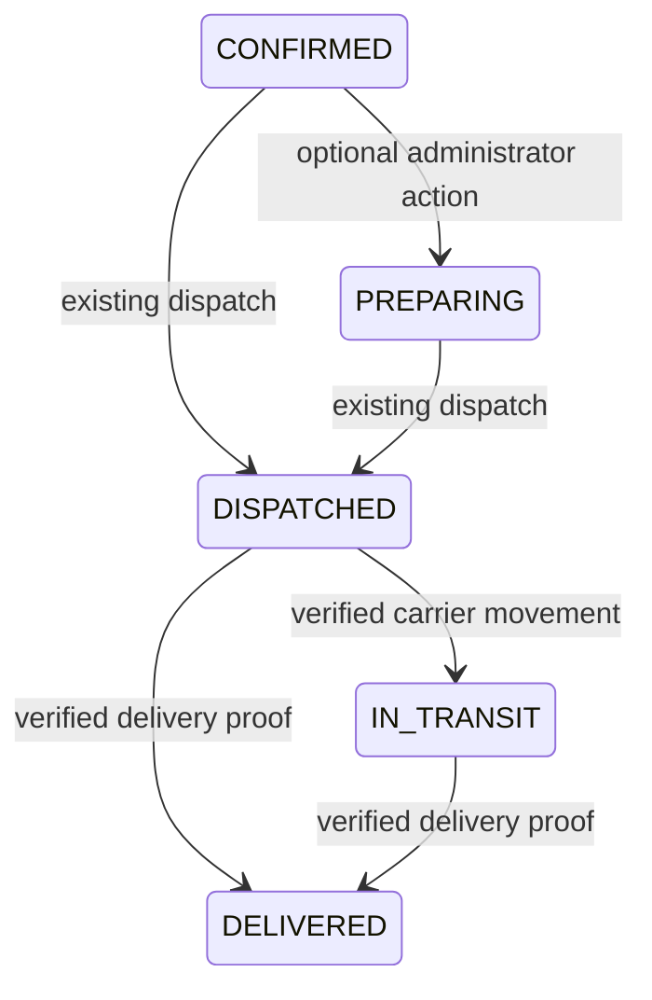

# Automatic carrier tracking foundation — Issue #167

## Scope and baseline

Baseline: `afeaa1110e9c4844762ca75288030bfdbf42a897` (`origin/main`), including merged Phase 1 PR #166 / Issue #165, payment resolution #156 and password recovery #160. Local branch: `issue-167-automatic-carrier-tracking-foundation`. No duplicate Phase 2 implementation was found in remote branches.

This is an offline-safe foundation, **not a production carrier integration**. No real HTTP carrier adapters, webhook routes, credentials, automatic scheduler, AWS resources or live provider requests are implemented. Existing payment, refund, inventory and order lifecycle write paths are unchanged.

## Official carrier research

| Carrier | Verified official capability | Not verified / gated | Owner requirements |
| --- | --- | --- | --- |
| Royal Mail | Account-customer Tracking API products exist; onboarding requires account manager engagement, app registration and plan subscription/approval. App client ID/secret are issued. Limits depend on subscribed plan. | Current tracking request/authentication headers, event schemas and mappings, webhook support, exact quota, API cost and sandbox access were not obtained. A public preproduction portal does not establish unrestricted sandbox eligibility. | Confirm commercial account, approved tracking product/version, documentation, quota, credentials and test environment. |
| Evri | Business services offer tracking and integrations. Official Frequent Seller FAQ explicitly says API integrations are unavailable at that level. | No authoritative public tracking API contract, authentication, status codes, webhooks, rate limits or sandbox details obtained. Dashboard/marketplace integrations are not a bespoke API contract. | Establish eligible business integration and obtain official technical/commercial terms. |
| DPD UK | Official consumer and business sites expose tracking capabilities. | UK developer documentation was inaccessible; no verified UK endpoints, authentication, status mapping, webhook, quota, cost or sandbox contract. Other DPD countries' APIs cannot be assumed valid for UK. | Obtain UK account-specific integration documentation and commercial approval. |

Sources: [Royal Mail Tracking V2 product](https://developer.royalmail.net/product/175625/api/76888), [onboarding](https://developer.royalmail.net/start), [plan limits](https://developer.royalmail.net/help), [preproduction portal](https://pp.developer.royalmail.net/); [Evri Frequent Seller FAQ](https://www.evri.com/frequent-seller), [business accounts](https://www.evri.com/business-accounts); [DPD UK tracking](https://track.dpd.co.uk/search), [business site](https://business.dpd.co.uk/). No accounts were registered, credentials requested or live tracking APIs called.

## State and evidence

Shipment progress is the primary carrier truth. `OrderStatus` is unchanged; `FulfilmentStage` adds `IN_TRANSIT` and `DELIVERED` for read projections. Preparing remains optional.



`UNKNOWN` observations remain auditable without progress. Delivery exceptions are separate from monotonic progress: failed delivery, address issue, delay, damage, return-to-sender or unknown exception. A newer movement may clear an exception; an equal-time movement cannot hide it. Older/lower events are persisted as stale. Delivered is terminal; conflicting delivery timestamps or proof references are rejected and retained.

Canonical observations require exact carrier, normalized tracking number and stable, **nonsecret account namespace** (`providerIdentity`). Up to 100 events per observation; IDs/codes/references are bounded and control characters rejected. Events contain provider event ID, occurrence timestamp, canonical status, optional exception, provider status code, delivery confirmation/time and private evidence reference. Receipt and verification timestamps come from PostgreSQL. Unknown provider codes default to `UNKNOWN`; no Royal Mail/Evri/DPD mappings have been guessed.

`DELIVERED` requires verified evidence, explicit delivery confirmation, a nonempty evidence reference, and delivery time equal to event time. Events must be no earlier than dispatch and no more than **five seconds after database receipt time**. The same inclusive five-second bound is enforced by TypeScript and PostgreSQL; a timestamp one millisecond beyond it cannot be applied. Farther-future observations remain `REJECTED/FUTURE_EVENT` and may be re-evaluated on later observation when within tolerance, preserving their original rejection. Estimates, browser actions and elapsed time never prove delivery. Carrier clocks/time zones and evidence semantics must be validated before a real adapter is enabled.

Evidence sources: authenticated API, verified webhook, or test fixture. **These labels and `verified` are assertions from internal adapter code, not independent cryptographic authentication. The database validates consistency and delivery-proof fields, not carrier authenticity. No real carrier authentication implementation currently exists.** They are not customer claims. There is no public ingestion endpoint. Future webhook integration must verify signatures/identity before constructing this input. Test adapters are unavailable outside `NODE_ENV=test`; PostgreSQL rejects fixture evidence outside `colorful_life_test`.

## Persistence and migration

Seven additive tables:

- `ShipmentCarrierEvidence`: immutable stable carrier fields, unique shipment/account/provider-event identity and raw-field fingerprint.
- `ShipmentTrackingEvent`: append-only normalized evaluation snapshots linked to carrier evidence, unique identity/evaluation key, applied/stale/rejected/unknown disposition.
- `ShipmentTrackingState`: current per-shipment progress, proof pointers, exception and version.
- `ShipmentTrackingSync`: opt-in configuration, due time, counters, lease owner/generation, safe error codes.
- `TrackingCarrierBudget`: shared account/carrier fixed-minute and UTC-day request counters.
- `ShipmentTrackingPoll`: durable request journal and completion outcome.
- `ShipmentTrackingConflict`: immutable, deduplicated normalized contradictory evidence linked to the original event.

Migrations:

1. `20261018120000_carrier_tracking_foundation`: enum additions, first five tables/indexes/FKs and guards.
2. `20261018121000_tracking_delivery_proof_check`: explicit non-NULL delivery time/reference validation (SQL CHECK NULL semantics).
3. `20261018122000_tracking_conflict_evidence`: conflict audit table/index/FK and immutability guard.
4. `20261018123000_tracking_nonblank_delivery_proof`: reject whitespace-only delivery references.
5. `20261018124000_tracking_evaluation_recovery`: separate stable evidence from evaluations, retain legacy snapshots, five-second clock tolerance, append-only evidence triggers and monotonic budget guards.

No backfill, stock updates, payment updates, historical order changes or invented evidence. Historical shipments remain untracked; legacy orders without Shipment rows retain Phase 1 fallback display and are not automatically enrolled. Evidence FKs restrict deletion. Statement triggers reject DELETE (even zero-row deletes) and TRUNCATE (including CASCADE) on stable evidence, evaluations and conflict tables; UPDATE is also blocked. DROP of an explicitly isolated disposable test schema remains possible, so migration tests do not need to disable guards or delete shared evidence. Runtime roles must not own these tables, disable triggers, set replication bypass modes, or have DDL/TRUNCATE privileges. Privileged database maintenance/backup restoration requires an explicit controlled administration procedure; superuser/owner trigger bypass is outside application guarantees. Poll journals are operational records rather than immutable carrier evidence.

Each migration explicitly uses a transaction and five-second lock timeout. PostgreSQL 12+ is required for transactional enum additions. DDL still briefly locks existing Shipment and enum/catalog objects: inspect deployment lock contention and use a controlled migration gate before the new binary. Isolated PostgreSQL schema tests cover clean application, rollback and historical order/payment/stock preservation. The original four migrations were verified as finished, unrolled-back and checksum-matching in the persistent guarded test database. They are deliberately **not consolidated**: that database is not disposable, and rewriting its applied history would be unsafe. The fifth migration is additive. Its initial test application failed on an incorrectly spelled truncated index name and rolled back transactionally; after verifying absent new DDL, only that failed attempt was marked rolled back through Prisma and reapplied successfully. No successful migration was rewritten, no shared reset occurred and no manual SQL history edits were made. Never reset production or rewrite applied checksums. Rollback runtime activation first; do not drop durable evidence as a rollback mechanism.

## Transactions, deduplication and concurrency

Lock order: Order `FOR NO KEY UPDATE` → Shipment `FOR UPDATE` → tracking rows → account/carrier budget. The non-key Order lock matches Phase 1 and avoids inversion against refund foreign-key key-share locks. Every shipment transition rechecks current eligibility under these locks. Same-order shipments serialize conservatively. No Payment or inventory rows are written by tracking.

Identity fingerprints contain only stable carrier fields: carrier/account/tracking identity, provider event ID, occurrence time, raw provider status code, provider delivery timestamp and opaque evidence reference. Normalized status/exception, confirmation interpretation, verification assertion and transport channel are excluded. Adapters must distinguish stable provider fields from derived interpretation; no raw payload or customer address is retained.

`UNKNOWN` and retryably rejected (`UNVERIFIED`, `FUTURE_EVENT`, `MISSING_DELIVERY_CONFIRMATION`) observations may receive a new immutable evaluation when mapping, verification or time eligibility changes. Identical evaluations deduplicate; successful/stale/permanently rejected evaluations are not reinterpreted or downgraded. Re-evaluation is on a subsequent explicit ingestion/poll, not an automatic database timer. Already applied delivery proof remains immutable.

Genuinely changed stable fields under the same provider identity are conflicts. They are retained in the conflict table while independent valid events in the batch continue in the same transaction. Original evidence is never overwritten. A poll with conflicts is recorded as `PARTIAL_SUCCESS`/`EVIDENCE_CONFLICT`, remains enabled unless legitimately Delivered or otherwise exhausted, and does not consume the consecutive failure budget. Database persistence failures still roll back the transaction and are not acknowledged as success. API/webhook corroboration of the same stable observation remains idempotent.

Pre-remediation evaluation rows and their original hashes remain unchanged. On re-observation, stable evidence is lazily adopted from the original snapshot, so conflicting later input cannot establish a replacement identity. New evaluations use the stable hash and reference. No historical rows are rewritten. Stop any older tracking writer before migrating: its former single-row uniqueness assumptions must not coexist with the new evaluation protocol. Read-only consumers remain compatible.

Proof guards enforce same-shipment, verified applied evidence, dispatched order eligibility, nonregressing progress/date/version and immutable terminal proof. Shipment carrier/reference identity is frozen once sync or event history exists. Event and completed poll journals cannot be overwritten. Direct SQL with privileged trigger bypass is not part of the supported application boundary.

## Safe read contract and authorization

Existing customer `/orders` and `/orders/:orderId` ownership checks and ADMIN `/admin/orders` authorization remain unchanged. Fulfilment reads derive shipment progress, never change the financial order status. Administrators cannot manually assert Delivered through these changes.

Tracked shipment projections add only:

```json
{"tracking":{"progress":"IN_TRANSIT","lastEventAt":"2026-10-18T12:00:00.000Z","exception":null,"exceptionAt":null,"deliveredAt":null}}
```

Existing carrier name, tracking number, dispatch time and trusted tracking URL remain. No provider account identity, private evidence reference, raw status, credential, fingerprint, lease or budget is exposed. Untracked shipment projections retain the Phase 1 shape. Registered parcels all require delivery proof for order-level Delivered; partial delivery maps to In Transit. The future parcel creation/item allocation API and freezing the complete parcel set are deferred; this foundation does not create additional production parcels.

## Manual polling, budgets and recovery

`CARRIER_TRACKING_POLLING_ENABLED=false` by default. No polling worker is started by the API process. Manual entry point after build: `node dist/scripts/pollCarrierTracking.js`. It is a single bounded invocation with safe aggregate JSON output and SIGTERM/SIGINT abort handling. **Do not enable production polling in this phase.** The real adapter registry is empty, so even an enabled invocation makes no carrier requests. Test fixtures inject fake adapters explicitly.

Defaults: 20 requests/run (hard max 25), 60 seconds/run (hard max 120), 5 seconds/request (hard max 10), 10 requests/minute and 100/day per carrier/account, 100 lifetime requests/shipment, five consecutive failures, six-hour successful poll spacing. These are conservative local budgets, not verified carrier-plan entitlements. Policy inputs are bounded. Temporary/timeouts/rate-limit failures use one-minute exponential backoff capped at six hours. Permanent/invalid evidence, exhausted failure/lifetime budget and Delivered stop sync. Re-enabling never resets counters; a reviewed operator recovery procedure is needed for exhausted jobs.

The shared budget row is locked **before** sampling authoritative PostgreSQL time. Minute/day counters use that post-lock timestamp; both application logic and a database trigger prohibit backwards buckets or decreasing counters within a bucket, including database clock corrections. Deterministic tests hold a real PostgreSQL lock while advancing a logical clock across a minute boundary; the waiting worker cannot sample time early or restore an older bucket.

Claims, monotonically increasing generations, leases and poll journals are committed **before** external I/O. Account budgets are locked and charged before calls, including crashes. Provider I/O is outside transactions. Success ingest, state update, journal completion and claim release are atomic and generation-fenced. Expired claims are discoverable and old journals are closed, including when the job must stop. Late results cannot overwrite newer claims. Missing adapters/credentials defer jobs without charging request budgets. Budget-denied rows move their due time to the next budget boundary so they cannot occupy the queue forever.

A provider adapter must honour AbortSignal and enforce HTTP limits; a noncooperative adapter may finish an already-issued read after timeout, but its result is fenced and its charged request is not refunded. There are no provider financial operations. Database failures abort the invocation; durable leases allow later recovery. No unbounded loop, scheduler or automatic retry process exists.

## Recovery and administration

Mapping and verification upgrades need the same stable evidence identity, then normal re-ingestion; earlier rejected/unknown snapshots are retained. Future evidence beyond five seconds is reconsidered only on a later poll/explicit ingestion and must pass every other delivery check. No force-delivery or arbitrary timestamp editing is supported. Genuine conflicts require operator/provider investigation; they do not prevent unrelated events advancing or repeatedly stop a job.

After correcting an adapter/configuration problem, trusted internal `configureTrackingSync(shipmentId, adapter, true)` can re-enable an eligible shipment while preserving account identity and request/failure counters. No public recovery/admin-write endpoint is added. Jobs already at lifetime/failure exhaustion cannot be revived by this call; budget increases or audited recovery require a separately reviewed operation. Never delete evidence, reset counters, alter event timestamps, or bypass triggers to recover tracking. Investigate `EVIDENCE_CONFLICT`, stopped reasons and due-job age before activation.

## Production gates and remaining work

Before real activation: obtain official contracts and sandbox/commercial approval; implement reviewed provider normalization/authentication; verify quota, cost, rate-limit hints and abort semantics; establish credential storage; agree historical enrollment and parcel scope; review grants, evidence retention and bounded journal archival; coordinate frontend support for the new read stages; deploy additive migrations before code; run provider contract tests and a limited opt-in rollout. All instances must use the same account namespace and budget policy. Shared external account consumers must coordinate the same quota. Monitor due-job age, consecutive failures, lifetime exhaustion, expired leases, conflict counts and provider request totals; reviewed operator intervention is required for stopped jobs. No AWS provisioning is required here.

No automatic refund, inventory release, payment mutation, order completion or delivery email is introduced. Payment resolution #156 and manual fulfilment #165 remain independent. Mock success does not establish production readiness.

## Validation and proposed PR

Remediation focused validation: **123 passed, 0 failed, 0 skipped**, including **67 tracking tests** (57 PostgreSQL lifecycle/reliability/security tests, six contract tests and four migration tests). Full guarded backend suite: **1,188 passed, 3 intentional external sandbox skips, 0 failed** (1,191 total; 529.7 seconds). Build/typecheck, Prisma validation, migration status and `git diff --check` passed. All 59 migrations are applied in the guarded test database; the five successful tracking checksums match the files. Read-only schema comparison retains only pre-existing cart foreign-key drift, with no tracking drift. There is no repository lint command/configuration.

Reproductions covered explicitly: UNKNOWN remapping plus independent Delivered in one poll; verification upgrade and genuine mixed-batch conflict; a two-second future Delivered; retry of historical future rejection; exact five-second/one-millisecond bounds; lock wait across a simulated minute boundary; DELETE/TRUNCATE/CASCADE rejection; legacy upgrade preservation and transactional rollback.

Suggested title: `feat(fulfilment): add offline-safe carrier tracking foundation (#167)`.

Suggested description: Adds shipment-level verified tracking events, monotonic safe read projections, durable conflict evidence and a bounded manual polling framework. Includes five additive migrations with no historical backfill and PostgreSQL lifecycle/concurrency/security tests. Real Royal Mail, Evri and DPD integrations, credentials and production polling remain disabled and require separate commercial/contract and activation approval. References #167 and #161; builds on merged #166. No payment/refund/inventory write behavior changes.


## Changed-file manifest

- `docs/carrier-tracking-foundation.md`
- `prisma/migrations/20261018120000_carrier_tracking_foundation/migration.sql`
- `prisma/migrations/20261018121000_tracking_delivery_proof_check/migration.sql`
- `prisma/migrations/20261018122000_tracking_conflict_evidence/migration.sql`
- `prisma/migrations/20261018123000_tracking_nonblank_delivery_proof/migration.sql`
- `prisma/migrations/20261018124000_tracking_evaluation_recovery/migration.sql`
- `prisma/schema.prisma`
- `src/__tests__/carrierTracking.integration.test.ts`
- `src/__tests__/carrierTrackingContract.test.ts`
- `src/__tests__/carrierTrackingMigration.integration.test.ts`
- `src/config/index.ts`
- `src/domain/fulfilment/fulfilmentPresenter.ts`
- `src/domain/orders/orderReadService.ts`
- `src/domain/tracking/fakeCarrierAdapter.ts`
- `src/domain/tracking/trackingBudget.ts`
- `src/domain/tracking/trackingContract.ts`
- `src/domain/tracking/trackingPoller.ts`
- `src/domain/tracking/trackingService.ts`
- `src/generated/prisma-client/browser.ts`
- `src/generated/prisma-client/client.ts`
- `src/generated/prisma-client/commonInputTypes.ts`
- `src/generated/prisma-client/enums.ts`
- `src/generated/prisma-client/internal/class.ts`
- `src/generated/prisma-client/internal/prismaNamespace.ts`
- `src/generated/prisma-client/internal/prismaNamespaceBrowser.ts`
- `src/generated/prisma-client/models.ts`
- `src/generated/prisma-client/models/Shipment.ts`
- `src/generated/prisma-client/models/ShipmentCarrierEvidence.ts`
- `src/generated/prisma-client/models/ShipmentTrackingConflict.ts`
- `src/generated/prisma-client/models/ShipmentTrackingEvent.ts`
- `src/generated/prisma-client/models/ShipmentTrackingPoll.ts`
- `src/generated/prisma-client/models/ShipmentTrackingState.ts`
- `src/generated/prisma-client/models/ShipmentTrackingSync.ts`
- `src/generated/prisma-client/models/TrackingCarrierBudget.ts`
- `src/scripts/pollCarrierTracking.ts`
