# Refund provider safety — Issue #169

## Scope and baseline

Branch `issue-169-refund-provider-safety`, baseline `c38b73c295d0127b6502e8e678b72ba3a120b07f` (main including #167 / PR #168). Builds on [#52](https://github.com/colorful-life-ltd/colorful-life-backend/issues/52), retaining Refund as the intent/accounting aggregate. [#169](https://github.com/colorful-life-ltd/colorful-life-backend/issues/169) covers provider financial safety, not returns, restocking, paid-order cancellation or automatic refunds. No inventory, order-state, payment-principal or payment-status writes are introduced.

## Client API contract

Existing ADMIN routes remain:

- `POST /orders/:orderId/refunds`
- `GET /orders/:orderId/refunds`

New Stripe/PayPal intents require an **`Idempotency-Key` header**, 16–128 characters matching `[A-Za-z0-9._:-]`; use a fresh client-generated UUID per intentional refund. Generate/persist it before submission, and reuse it after response loss. Request body stays `{paymentId, amount, reason?}`. Currency and payment/provider identifiers are server derived. Free-text reason is normalized (trimmed) and stored locally, never sent as Stripe's reason or PayPal's customer-visible note.

The same key and normalized order/payment/provider/amount/reason return the original refund, including terminal FAILED. Changed parameters or a key tied to another payment/order/provider return 409. The first administrator remains the audit actor. A distinct key represents a distinct intent and is rejected while that payment has any PROCESSING refund (including historical ones) or unresolved evidence review. Pending/quarantined verified refund receipts with an exact matching provider payment/capture parent also block new intents, even without a correlated local refund. Sequential partial refunds are allowed after definitive completion/failure and resolution of genuine evidence conflicts.

The existing optional `refundId` identifies an existing intent; an unknown ID returns 404, never creates one. New managed intents still require matching stored amount/reason and any supplied client key. Legacy ID-based lookup remains readable without a key and never resubmits. Manual refunds retain their reference-based idempotency contract and do not require this header.

External refund response examples:

```json
{"refundId":123,"status":"PROCESSING","amount":"10","currency":"GBP","provider":"PAYPAL","resolutionCode":"PROVIDER_PENDING","reviewRequired":false}
```

- PROCESSING: **202**, including stable refund ID, safe resolution code and review flag. Timeout is not failure.
- Terminal: existing 201 convention for key-based create/replay, 200 for ID-based retrieval/replay.
- Competing unresolved intent or changed parameters: **409**, with original ID/status when known.
- Missing/invalid key: **400** before intent creation/provider I/O.
- Missing resource: 404; unauthorized/non-admin: 401/403.
- Persistence failure after known allocation: **503**, with the known ID, explicit `status: UNKNOWN` and reconciliation-required code. Do not generate a new client key in response to errors.

Existing manual request/reference semantics and status codes remain; manual record responses include the additive schema defaults. History keeps existing fields plus safe resolution diagnostics but omits new provider request/evidence internals. POST projections expose no provider keys, references, evidence, credentials or raw error bodies. Stored provider idempotency keys are separate from client keys and remain private in POST responses; history retains its pre-existing legacy fields.

## Financial protocol and invariants

Every financial transition follows Order `FOR NO KEY UPDATE` → Payment `FOR UPDATE` → Refund `FOR UPDATE`, then receipt where applicable. The non-key Order lock is compatible with legacy refund FK key-share locks and existing fulfilment conventions. Receipt persistence uses a separate receipt-only transaction that never waits for Order/Payment, avoiding lock inversion. All current state is reread under locks; receipt evidence is rechecked after locking.

New submission reserves capacity, creates the intent and records submission admission **before** external I/O. The database decision admits only one initial provider POST. An identical request arriving concurrently receives the durable existing PROCESSING record. A crash between journal commit and provider I/O may leave an unsubmitted but unresolved intent: this sacrifices availability rather than risking a duplicate payment.

Provider calls occur outside transactions. No provider POST is automatically replayed, even with the same provider key. This conservative policy does not depend on uncertain provider key retention. Stripe SDK network retries are explicitly disabled; PayPal fetch has no retry loop. A lost response keeps the same intent/reservation until verified evidence or manual review resolves it. Legacy unresolved intents are never automatically resubmitted.

All synchronous, webhook and manual-GET outcomes use one finalizer:

```mermaid
stateDiagram-v2
    [*] --> PROCESSING: reserve and journal
    PROCESSING --> PROCESSING: pending / unknown / timeout
    PROCESSING --> SUCCEEDED: verified success; consume own reservation once
    PROCESSING --> FAILED: verified terminal failure or definitive original rejection; release once
```



Successful accounting is atomic: decrease reservedRefundAmount and increase refundedAmount by this refund's amount, alongside its status/evidence. Failure releases only the reservation. Payment principal/currency/status/paidAt, Order, ownership, returns and inventory remain unchanged. Duplicate terminal observations cannot move capacity again or consume another refund's reservation. Success never regresses. Contradictory terminal outcomes are retained for review, block further intents and never silently consume another reservation. Historical aggregate inconsistencies are not repaired speculatively; accounting fails closed with durable webhook evidence retained.

Manual refund accounting now also respects reserved capacity and the unresolved-intent gate. Cross-payment client-key collisions roll back losing reservations before reporting conflict. Retry only database-only work after rereading; no transaction retry callback includes provider POST. The implementation adds no automatic transaction retry loop.

## Stripe behavior

Create requests omit provider reason; the original human note remains local. Stripe accepts only `duplicate`, `fraudulent`, or `requested_by_customer`, and API v1 keys may be pruned after 24 hours: [create contract](https://docs.stripe.com/api/refunds/create), [idempotency](https://docs.stripe.com/api/idempotent_requests).

Only an original StripeInvalidRequestError HTTP 400 with an explicit formatting/parameter rejection code is classified as definitive no-execution rejection. Timeouts, 5xx, idempotency conflicts, unknown errors and malformed responses remain unresolved. A later rejection must not be used to infer that an earlier ambiguous submission failed; this implementation never resubmits that earlier intent.

Validate provider refund identity, PaymentIntent, amount, currency and metadata where available. A bound refund reference cannot change. Pending/requires_action retains reservation; succeeded finalizes once; verified failed/canceled releases once. A malformed/mismatched response holds capacity for review.

## PayPal behavior

New requests use UUID provider request IDs, `Prefer: return=representation`, and `custom_id=cl-refund-<local ID>`. No admin note is sent to customers. PENDING binds the validated identity and retains capacity. COMPLETED finalizes once; validated FAILED/CANCELLED releases once. Unknown HTTP errors and unrecognized statuses retain capacity. Only an original HTTP 400 INVALID_REQUEST with allowlisted format issues is definitive rejection. Status alone never permits releasing a mismatched amount/capture/currency.

An incomplete POST response with a candidate ID is retained for manual GET validation. GET uses a fixed configured endpoint, never follows supplied URLs, and validates the returned ID, capture parent, amount, currency and custom ID where available. Supplied invalid parent links are not ignored. Verified completion clears ordinary recovery holds, permitting sequential partial refunds; actual conflicting evidence remains under review.

Official references: [refund capture](https://developer.paypal.com/api/payments/v2/captures-refund), [refund statuses](https://developer.paypal.com/api/payments/v2/definitions/refund/), [refund details](https://developer.paypal.com/api/payments/v2/refunds-get). PayPal documents retention as endpoint-specific; this implementation assumes no indefinite POST protection: [idempotency](https://developer.paypal.com/api/rest/reference/idempotency/).

## Webhooks and durable recovery

Existing Stripe signature verification and PayPal signature-verification endpoint remain prerequisites. Test seams never replace the database locking in concurrency tests. A normalized `version:2, kind:refund` allowlist is persisted in existing PaymentWebhookEvent before processing/HTTP acknowledgement. No headers, credentials, addresses or raw provider payloads are stored. Deduplication targets exactly provider/event ID via ON CONFLICT; conflicting evidence is rejected. No blanket Prisma P2002-success catch remains in Stripe refund reconciliation. Persistence/processing failures return HTTP 500, not successful acknowledgement.

Use the bound provider refund ID or exact local metadata/custom ID, with matching financial/parent identity. Never infer identity from same amount or cumulative capture-refunded totals. PayPal refund IDs and capture IDs are decoded separately. Missing correlation or required evidence remains pending for replay/manual review. Processed mismatches retain durable evidence and a review flag. Duplicate success, late pending and simultaneous webhook/synchronous completion cannot regress money/status. A delayed contradictory terminal notification is conservatively flagged rather than silently ignored.

PayPal's documented refund events are PAYMENT.CAPTURE.REFUNDED, PAYMENT.REFUND.PENDING and PAYMENT.REFUND.FAILED; no invented REFUND.COMPLETED event is used: [event names](https://developer.paypal.com/api/rest/webhooks/event-names/). Type/status contradictions remain unknown. The existing PayPal inbox replay worker recognizes the new refund evidence; it performs database processing only, with **no provider calls**. No new background scheduler is introduced. Stripe uncorrelated receipts can be processed explicitly through the shared receipt processor.

Old evidence-less Stripe receipts can receive verified evidence on redelivery. Existing non-null incompatible legacy PayPal receipt evidence is not overwritten or guessed into a refund binding; such history may need explicit provider GET/manual review. No historical receipts, refunds or financial counters are bulk rewritten or deleted. Refunds performed outside this application still require operational reconciliation; no local lock can prevent an independent provider-dashboard action that has not yet been reported.

## Manual reconciliation endpoint

`POST /orders/:orderId/refunds/:refundId/reconcile`, ADMIN only, empty body.

**`REFUND_RECONCILIATION_ENABLED=false` by default.** Disabled returns 503. Enabling requires operational approval, correct provider account/environment credentials and a reviewed runbook. It does not start a scheduler. There is no CLI loop, polling process, automatic refund retry or AWS resource.

Each explicit invocation permits at most one provider refund-detail GET, with a five-second timeout, and at most eight attempts per refund in total. Attempts are charged transactionally before I/O, including failures/crashes, so parallel instances cannot exceed that lifetime limit. Real PayPal calls also include OAuth authentication within the same timeout budget. Parallel read completion is financially idempotent through the finalizer.

No known/candidate provider refund ID means MANUAL_REVIEW_REQUIRED and no provider call. Eight exhausted attempts require review, never imply failure and never release capacity. Provider outages/404/invalid responses retain reservations. Verified subsequent webhook/GET success resolves ordinary uncertainty; conflicting financial evidence remains flagged. No API resets the attempt counter, clears genuine conflicts or force-marks refunds failed. Operator review of unknown-ID cases must use trusted provider records/support; never replay an expired idempotency key, delete the intent or release capacity from a timeout.

## Migration and deployment

One additive migration: `20261019120000_refund_provider_safety`.

Eight justified columns on Refund:

- clientRequestKey: durable client identity with unique index.
- providerPaymentReference: frozen submitted PaymentIntent/capture identity.
- submissionStartedAt: durable one-time submission admission.
- resolutionCode: safe operational outcome.
- reviewRequired: admission gate for unresolved conflicting financial evidence.
- reconciliationAttempts: durable eight-attempt manual GET limit.
- providerOutcome: immutable terminal validated evidence/rejection classification.
- reviewEvidence: sanitized contradictory evidence or incomplete response candidate ID.

Adds payment/status lookup index, managed-identity checks, bounded/nondecreasing reconciliation counter, immutable submitted identity/provider binding/terminal state and terminal evidence guards. Existing rows receive null/default metadata; no historical submission timestamp, client key, provider finality or accounting is fabricated. There is no new enum, operation table, generic recovery framework, lease scheduler or data cleanup.

DDL is transactional with five-second lock timeout. ALTER/unique index/trigger installation still requires PostgreSQL locks: pause refund writes, inspect contention and use a controlled cutover. Stop all old refund writers before migration/new code; old binaries can bypass the new admission/finalization protocol even though the schema is additive. Migrate before new binaries, coordinate API consumers to supply stable client keys, validate role grants and provider environment/webhook subscriptions, then resume reviewed writes. Manual GET remains disabled until separately activated.

Use non-owner runtime roles with only necessary table/sequence access; do not grant trigger bypass or allow deletion/truncation of financial history. Privileged SQL/administrative data deletion is outside application idempotency guarantees. No automatic historical repair is attempted. Preserve unknown legacy reservations and investigate them with authoritative evidence. Rolling back to old refund writers would reintroduce the audited defects; disable refund writes rather than rolling back the safety protocol or dropping audit data.

## Validation and review

Focused refund run before final review: 96 passed, zero failures/skips, including 40 new tests. Relevant payment/cancellation/fulfilment regressions: 153 passed, zero failures/skips. The latest standalone safety/client/migration run passes all **44 new tests**, including expired-key and post-submission-persistence-failure coverage; these overlap with the focused run. **Full backend suite: 1,232 passed, 3 intentional external sandbox skips, 0 failed** (1,235 total; 530.0 seconds). Build/typecheck, Prisma validation, migration status and diff checks passed. Only the guarded test database received the new migration; all 60 migrations are recorded as applied there. New tests include real PostgreSQL concurrency, lost HTTP/provider responses, same/different-key races, exact-once accounting with multiple historical reservations, pending success/failure, unknown/mismatched/duplicate/delayed evidence, persistence faults, bounded GET recovery, timeout, authorization, wire-contract fakes, migration rollback and historical financial/stock preservation.

Provider clients are local fakes; no real refund/sandbox financial operation is used. The injected persistence-failure test deliberately faults transaction entry; the financial race tests use real transactions and locks. Prisma validation/build/migration consistency are checked without changing production/development data. Known pre-existing cart FK schema drift remains outside this issue.

No independent audit approval is claimed. Ready only for a separate security review after final validation; commit, push, PR, migration to production and deployment each require separate approval.

## Changed-file manifest

- `docs/refund-provider-safety.md`
- `prisma/migrations/20261019120000_refund_provider_safety/migration.sql`
- `prisma/schema.prisma`
- `src/__tests__/paypalRefundService.test.ts`
- `src/__tests__/refund.integration.test.ts`
- `src/__tests__/refundProviderClients.test.ts`
- `src/__tests__/refundProviderSafety.integration.test.ts`
- `src/__tests__/refundProviderSafetyMigration.integration.test.ts`
- `src/__tests__/stripeRefundService.test.ts`
- `src/__tests__/stripeRefundWebhookSandbox.integration.test.ts`
- `src/config/index.ts`
- `src/controllers/paypalWebhookController.ts`
- `src/controllers/refunds.ts`
- `src/controllers/stripeWebhookController.ts`
- `src/domain/payments/paypalReconciliationService.ts`
- `src/domain/payments/stripeReconciliationService.ts`
- `src/domain/refunds/paypalRefundService.ts`
- `src/domain/refunds/refundCapacityService.ts`
- `src/domain/refunds/refundLifecycleService.ts`
- `src/domain/refunds/refundReconciliationService.ts`
- `src/domain/refunds/refundService.ts`
- `src/domain/refunds/refundWebhookService.ts`
- `src/domain/refunds/stripeRefundService.ts`
- `src/generated/prisma-client/internal/class.ts`
- `src/generated/prisma-client/internal/prismaNamespace.ts`
- `src/generated/prisma-client/internal/prismaNamespaceBrowser.ts`
- `src/generated/prisma-client/models/Refund.ts`
- `src/routes/orders.ts`

## F1: PayPal response-link host compatibility

PayPal response links are identity evidence only: the service never follows or fetches an `up` URL. Live configuration accepts only `api-m.paypal.com` and `api.paypal.com`; sandbox configuration accepts only `api-m.sandbox.paypal.com` and `api.sandbox.paypal.com`. Unknown configured hosts and cross-environment links fail closed. HTTPS, no user information, no non-default port, no query/fragment, and the exact `/v2/payments/captures/{captureId}` path are required. The capture identity must match the locally frozen parent. Multiple supplied parent links must agree. Authenticated refund-client requests reject HTTP redirects, including OAuth requests.

This accommodates PayPal's documented refund response shape without relaxing capture correlation ([refund POST](https://developer.paypal.com/api/payments/v2/captures-refund), [refund GET](https://developer.paypal.com/api/payments/v2/refunds-get)). A minimal authenticated POST response may retain a bounded, syntactically valid refund ID as a GET-recovery candidate, but only after every supplied parent/custom identity corroborates the request. This does not finalize the refund or release capacity. Under the existing Order → Payment → Refund locks, a delayed incomplete POST cannot replace a refund identity already bound by a webhook. A contradictory or malformed candidate is not retained as a recovery reference.

Regression coverage includes both environments, both official host variants, cross-environment and malicious links, redirect rejection, POST completion, verified HTTP webhook and manual GET races, duplicate completion, incomplete-response GET recovery, and identity conflicts. The larger F2 operator-resolution workflow remains out of scope; missing or contradictory evidence still requires review and never triggers a blind provider POST retry.

F1 remediation validation: **65 targeted tests passed, 0 failed/skipped**; **full backend suite 1,240 passed, 3 intentional external sandbox skips, 0 failed** (1,243 total). Eight additional regressions cover this remediation. TypeScript build and Prisma validation passed; the guarded test database reports all 60 migrations applied. Migration SQL and generated clients were unchanged by F1. Schema diff contains only the previously documented cart foreign-key drift. `git diff --check` passed. Provider calls were mocked; no real refund or live provider operation was performed. Independent re-review of F1 remains pending.
